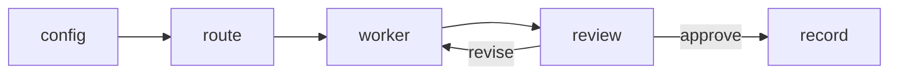

# CSL-27 — first harness slice

Date: 2026-10-15. Parent issue: CSL-27. This note is the research summary and
the architecture chosen for the first executable slice. It does not select a
product language, store, framework, or sandbox.

Gate, from the repository root:

```text
python -X utf8 -B tools/ci_gate.py --force
```

That command is provider-free. It byte-compiles this package and runs
`scripts/tests/v3/harness/harness.test.py` with the rest of the suite. The
tests stub every provider. They do not start Claude, Codex, or Grok.

## What was already decided

Source-documented, from the accepted product record:

- Recursion is one platform over models, harnesses, and subscriptions. Native
  execution and upstream harness execution are both release requirements, and
  either must be useful on its own. Upstream-only work must not depend on a
  hidden API key. Ordinary status does not need a model call.
  [PRODUCT](../PRODUCT.md) (OR-021–OR-025), [DECISION-REGISTER](../DECISION-REGISTER.md)
  OR-022.
- One CLI addresses goals in both modes. A delegated route keeps the upstream
  inner loop and uses only that harness's supported interface. For Claude,
  the unmodified Claude Code binary keeps the user's own sign-in. Recursion
  does not collect upstream session tokens. [CLI](../CLI.md).
- Usage figures are observations. A missing counter is unknown, not zero.
  Summing a parent and a fork, or summing cumulative session totals as if
  they were separate turns, double-counts. Codex, Claude, and Grok reset or
  aggregate differently. [EXECUTION-FABRIC](../EXECUTION-FABRIC.md).
- The public thesis is a harness that drives the subscriptions the user
  already has, without holding credentials it was not granted.
  [ANCHOR](../../../ANCHOR.md).

The 2026-10-13 meeting (CSL-27) asked for a harness that can be built and
tested, with routing through other harnesses by CLI headless flags so the
product stays inside those tools' terms. That is the slice below. It is not
the native model loop, the multi-node fabric, or a launch of every
compatibility name.

No language is selected. The existing v3 checks are Python, so this slice
lives under `scripts/v3/harness/` beside them. A later comparison can replace
it. OR-017 and OR-020 stay open.

## Chosen architecture

An upstream CLI broker:

1. Load `config/harness.json` (version 1). It names providers, capabilities,
   and session budgets. It refuses credential-shaped keys.
2. Choose the worker deterministically: the first enabled provider in
   `routing.preference` that has every required capability. No model call.
3. Run that adapter. `fixture` and `fixture-b` never start a process. `claude`,
   `codex`, and `grok` start only with `--allow-live`.
4. When another capable provider is enabled, ask it to review. The verdict is
   read from the assistant text, not from the raw stream.
5. Add known usage. Stop when a known figure is above its ceiling. Missing
   figures do not become zero.
6. Write one JSON run record and return it. `status` reads that record.



M1B route admission is unchanged and is not called here. Binding this broker
to a schema-valid route decision is later work. Landing, worktrees, logs,
and the other launch-critical adapters are later work.

The behavior is ported from the standalone fork `CDanTheMan/recursion` at
`5897a94` (v0.1.0) and cut down to this path. Fork-only landing, worktrees,
cooldowns, and the extra adapters are not in this slice.

## Fixes from the live fork run

These three failures were reported from a live run of that fork. This slice
includes the code they sit in, and the tests are stubs.

1. **Grok review verdict.** Grok `--output-format streaming-json` writes JSON
   events. The old reader required the first raw line to be exactly
   `VERDICT approve` or `VERDICT revise`, so a real review was `revise`.
   The slice joins `type: text` chunks, ignores thoughts and tool calls, and
   accepts a verdict line anywhere in that text.
2. **Codex budget.** Codex `turn.completed.usage` is a cumulative session
   total, not the current context window. A documented session reported 6.9M
   input tokens against a 272k window
   ([openai/codex#17539](https://github.com/openai/codex/issues/17539),
   source-documented, not re-measured here). The last event is kept and
   events are not summed. The default ceiling is 50,000,000 input tokens and
   8,000,000 output tokens, above that 6.9M example. The old 1,000,000
   ceiling still stops that example when it is configured.
3. **Claude Code doctor.** `claude auth status` can exit 1 while printing
   `{"loggedIn": true}` (a signed-in subscription with a non-zero status).
   The old probe treated exit 1 as signed out. `loggedIn` now decides.
   The exit code is used only when the output has no `loggedIn` field.
   Stdout and stderr are both read. The report does not keep the command
   output. Disabled providers are not probed.

## What this does not prove

- No live Claude, Codex, or Grok process was started here.
- The 6.9M Codex figure is a public report, not a measurement from this repo.
- A raised ceiling is not a qualified subscription meter.
- Passing the gate is not v3 release acceptance.
